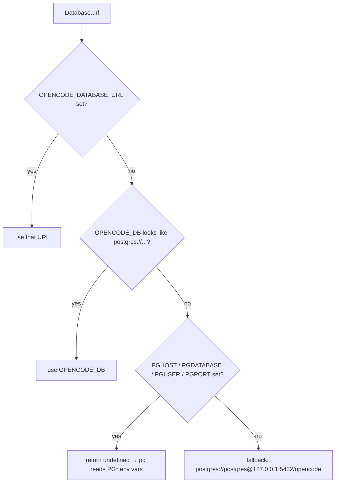
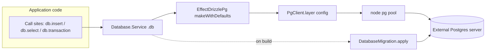
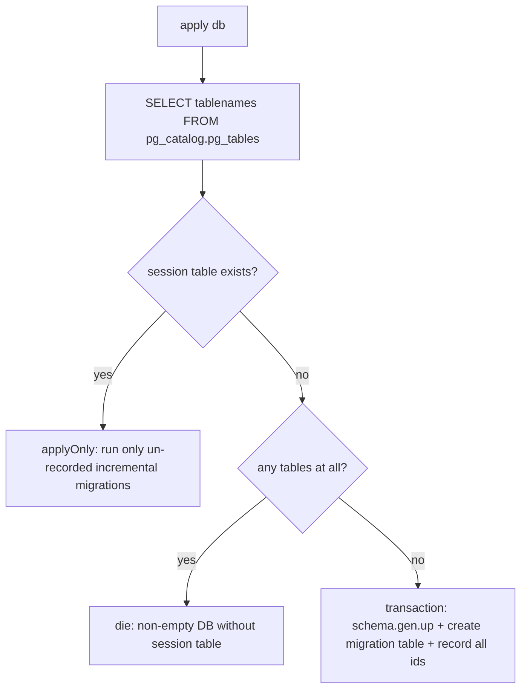
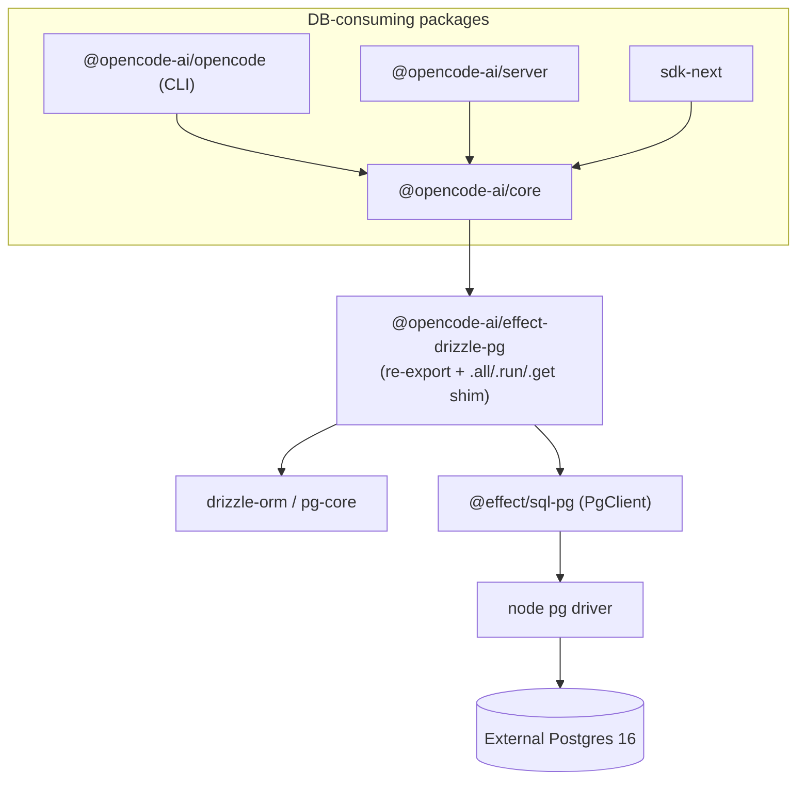

# SQLite → Postgres Migration: Architecture & Changes

This document explains **what** changed, **where** it changed, **how** it works,
the **resulting architecture**, and the **benefits** of moving opencode's
datastore from an embedded SQLite file to an **external, config‑swappable
Postgres server**.

> Looking for setup / usage / env vars / dev‑server instructions? See
> [`database-setup.md`](./database-setup.md). The original design plan lives at
> [`packages/core/src/database/POSTGRES_MIGRATION.md`](../packages/core/src/database/POSTGRES_MIGRATION.md).

---

## 1. Summary

opencode previously stored all durable state in a **local SQLite file** accessed
through a custom **Effect + Drizzle** stack. It now talks to an **external
Postgres server** selected entirely through configuration, so the same binary can
point at a local container, a shared team database, or a managed cloud Postgres
without code changes.

The migration was possible with a bounded blast radius because **almost every
call site already uses the dialect‑agnostic Drizzle query builder**
(`db.insert().values().onConflictDoUpdate()`, `db.select()`, `db.transaction()`).
Those APIs are identical in Drizzle `pg-core`, so the bulk of application code did
not change — the work concentrated in the schema definitions, the driver/runtime
layer, the adapter package, and the migration runner.

---

## 2. What changed (at a glance)

| Area | Before (SQLite) | After (Postgres) |
| --- | --- | --- |
| Engine | Embedded SQLite file (`better-sqlite3` / `bun:sqlite`) | External Postgres server (`@effect/sql-pg` → node `pg`) |
| Drizzle dialect | `drizzle-orm/sqlite-core` | `drizzle-orm/pg-core` |
| Adapter package | `@opencode-ai/effect-drizzle-sqlite` (vendored) | `@opencode-ai/effect-drizzle-pg` (thin re‑export + shim) |
| Driver files | `sqlite.node.ts`, `sqlite.bun.ts`, `#sqlite` conditional import, PRAGMAs | Single `PgClient.layer({ url })` for node **and** bun |
| Connection | Fixed local file path (`OPENCODE_DB`) | Config‑swappable URL (see resolution order below) |
| Migrations | 38 historical SQLite incremental files + PRAGMAs | One squashed Postgres baseline; empty incremental set |
| Tooling | `drizzle.config` sqlite dialect; `db` CLI → sqlite shell | `dialect: "postgresql"`; `db` CLI → `psql` |
| Timestamps / seqs | `integer` | `bigint({ mode: "number" })` |
| JSON columns | `text` | `jsonb` |
| Booleans | `integer` (0/1) | `boolean` |

---

## 3. Where it changed (file map)

All paths are relative to the repo root.

### New package — `packages/effect-drizzle-pg/`
The Postgres twin of the old vendored SQLite adapter. It is intentionally **thin**:

- `src/index.ts` — re‑exports the upstream `drizzle-orm` Effect‑Postgres bindings
  (`drizzle-orm/effect-postgres`, `effect-postgres/migrator`, `effect-core`
  logger) and pulls in the shim.
- `src/shim.ts` — restores the `.all()` / `.run()` / `.get()` terminal helpers
  that the opencode codebase relied on from the SQLite adapter. Upstream Effect
  query builders are themselves `Effect` values (yielding runs the query), so
  `all`/`run` return the builder unchanged and `get` maps to the first row. This
  keeps every call site **dialect‑agnostic**.

### Driver / runtime — `packages/core/src/database/`
- `database.ts` — the heart of the change. Builds the `Database.Service` from a
  single `PgClient.layer(config)`, resolves the connection string
  (`url()` / `connectionConfig()`), and exposes `layerFromUrl` / `layerFromConfig`
  for tooling and tests.
- `migration.ts` — Postgres migration runner (empty‑DB baseline vs. incremental
  apply; `pg_catalog.pg_tables` probe; transactional `migration` bookkeeping).
- `schema.gen.ts` — the squashed **Postgres** baseline DDL (19 `CREATE TABLE`
  statements) applied to a fresh database.
- `migration.gen.ts` — the (empty) Postgres incremental migration set.
- `path.ts` — custom column types now import from `drizzle-orm/pg-core`.
- **Deleted:** `sqlite.node.ts`, `sqlite.bun.ts`, `sqlite.ts`, and the 38
  historical `migration/*.ts` SQLite files.

### Schema files (`*sql.ts`, 11 files across `packages/core/src`)
Converted `sqlite-core` → `pg-core` with the type map above
(`event/sql.ts`, `project/sql.ts`, `session/sql.ts`, `permission/sql.ts`,
`share/sql.ts`, `schema.sql.ts`, etc.).

### Config & flags
- `packages/core/src/flag/flag.ts` — added `OPENCODE_DATABASE_URL` (alongside the
  existing `OPENCODE_DB`).

### Tooling
- `packages/core/drizzle.config.ts` — `dialect: "postgresql"`, URL from
  `OPENCODE_DATABASE_URL` → `OPENCODE_DB` → local default.
- `packages/opencode/src/cli/cmd/db.ts` — `opencode db` opens a `psql` shell (or
  runs a query through the Effect `db`), and `opencode db connection` prints the
  resolved connection.

### Removed
- Whole packages `packages/effect-drizzle-sqlite/` and
  `packages/effect-sqlite-node/`, plus the `@effect/sql-sqlite-bun` catalog entry.

---

## 4. How it works

### 4.1 Connection resolution (config swapping)

`Database.url()` in `database.ts` resolves the target Postgres in this order:

- `connectionConfig()` turns that into a `PgClient.PgPoolConfig`: an explicit
  `{ url }`, or `{}` (empty) so the underlying node `pg` driver reads the standard
  `PG*` environment variables itself.
- `layerFromUrl(connectionString)` builds a `Database` layer for an **arbitrary**
  connection string — used by tooling and tests that target a second database.

### 4.2 Runtime layering

When the `Database.Service` layer is constructed it (1) builds the Drizzle client
over `PgClient`, then (2) runs `DatabaseMigration.apply(db)` before yielding the
service — so the schema is guaranteed present before any query runs.

### 4.3 Migration strategy

A **fresh Postgres database is always empty**, so opencode does not replay the 38
historical SQLite migrations. Instead:

- Empty DB → apply the squashed `schema.gen.ts` baseline in one transaction and
  mark every known migration id as already completed.
- Existing DB with a `session` table → apply only incremental migrations that are
  not yet recorded in the `migration` bookkeeping table.
- Non‑empty DB **without** a `session` table → fail loudly (protects against
  pointing at an unrelated database).

### 4.4 Concurrency correctness (async pg vs. sync SQLite)

SQLite ran synchronously, so many operations never interleaved. Real Postgres I/O
is asynchronous and genuinely concurrent, which surfaced one latent race in
`SessionInput` prompt promotion: two concurrent `promoteSteers` callers could both
read the same unpromoted `session_input` row. The losing promotion's durable
`Prompted` transaction rolls back (its duplicate `session_message` insert fails
during projection, **before** any event row is written) and surfaces a defect.

The fix broadens the existing idempotency guard in `session/input.ts` `publish`:
on **any** post‑rollback defect it re‑reads the row and treats it as a no‑op when
the input is already promoted (`promotedSeq` set); otherwise it re‑raises. Result
under concurrency: exactly **one** event, **one** message, `promoted_seq = 1`.

---

## 5. Present architecture

- **Single source of truth:** `packages/core` owns the schema, driver, and
  migration runner. Every other package consumes the DB through
  `Database.Service`.
- **Dialect‑agnostic call sites:** application code uses the Drizzle query builder
  plus the shim helpers, so it is insulated from the underlying engine.
- **Config‑driven placement:** the connection string is resolved at runtime, so
  local, shared, and cloud Postgres are all selectable without a rebuild.

---

## 6. Benefits

- **External & shareable.** State no longer lives in a single machine's file.
  Multiple processes / machines / a team can share one Postgres server.
- **Config‑swappable.** One env var (`OPENCODE_DATABASE_URL`) repoints the whole
  app; standard `PG*` vars and managed cloud URLs work out of the box.
- **Concurrency & scale.** A real server handles concurrent connections,
  connection pooling, and larger datasets far better than a single‑writer SQLite
  file — and the migration hardened a real concurrency race in the process.
- **Operational tooling.** Backups, replication, monitoring, roles, and
  point‑in‑time recovery come from the Postgres ecosystem for free.
- **Richer types.** Native `jsonb`, `boolean`, `bigint`, and `double precision`
  replace SQLite's affinity‑based approximations, improving query power and
  integrity.
- **Bounded, reversible design.** The engine sits behind one `Database.Service`
  and a thin adapter; call sites stayed dialect‑agnostic, so the surface area of
  the change (and of any future change) is small.

---

## 7. Verification status

- Typecheck clean across `core`, `opencode`, `server`, `sdk-next`, and
  `effect-drizzle-pg`.
- `packages/core` test suite runs green against a real Postgres 16 server, with
  the only remaining failures being pre‑existing, environment‑specific timeouts
  (git / filesystem / subprocess) unrelated to the datastore.

See [`database-setup.md`](./database-setup.md) for how to reproduce this locally.
